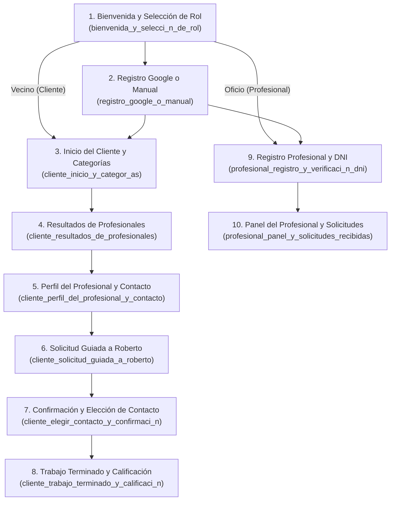

# Guía de Oficios — Especificación Funcional y Técnica (Alineada 100% a Stitch UI)

> [!IMPORTANT]
> **Diseño Gráfico Congelado (Stitch Original):**  
> Toda la interfaz gráfica exportada de Stitch se conserva intacta sin alteraciones visuales en [`ui-stitch/`](../ui-stitch/). El backend en Golang, la base de datos PostgreSQL/PostGIS y los componentes de Android Studio están adaptados exactamente a las **10 pantallas** y al sistema de diseño [`ui-stitch/gu_a_de_oficios/DESIGN.md`](../ui-stitch/gu_a_de_oficios/DESIGN.md).

---

## 1. Mapa de las 10 Pantallas Oficiales de Stitch y sus Funcionalidades

### Detalle Funcional Pantalla por Pantalla

| # | Carpeta Stitch | Funcionalidades Desarrolladas en Backend Go y Android | Endpoint API Conectado |
| :--- | :--- | :--- | :--- |
| **1** | [`bienvenida_y_selecci_n_de_rol`](../ui-stitch/bienvenida_y_selecci_n_de_rol/code.html) | • Selector interactivo de rol: *"Necesito un oficio para mi casa"* (`client`) vs *"Ofrezco mis servicios de oficio"* (`professional`). • Acceso a inicio de sesión o comienzo directo según perfil. | `GET /api/v1/auth/me?role={role}` |
| **2** | [`registro_google_o_manual`](../ui-stitch/registro_google_o_manual/code.html) | • Botón *"Continuar con Google"* (`auth_provider = 'google'`). • Registro manual con selector *"Busco oficios"* / *"Soy profesional"*, Nombre completo, Teléfono con prefijo (para WhatsApp), Email y Contraseña con botón de mostrar/ocultar. | `POST /api/v1/auth/register` |
| **3** | [`cliente_inicio_y_categor_as`](../ui-stitch/cliente_inicio_y_categor_as/code.html) | • Saludo personalizado (*"¡Hola, María!"*, badge *"Vecina activa"*) y ubicación guardada (*"Av. Rivadavia 5420, Caballito"*) con botón *"Cambiar dirección"*. • Buscador de problemas (*"Ej. Pierde agua la canilla"*). • Asistente contextual *"¿No sabés qué profesional necesitás?"* -> *"¿Qué está pasando?"*. • Grilla de 8 oficios en 2 columnas con badges especiales: **Gasista (`Matriculados`)** y **Cerrajero (`Urgencias`)**. | `GET /api/v1/categories` `POST /api/v1/diagnostic` |
| **4** | [`cliente_resultados_de_profesionales`](../ui-stitch/cliente_resultados_de_profesionales/code.html) | • Chips de filtrado: **Todos (8)**, **Urgencias hoy**, **Matriculados**, **Mejor valorados**. • Tarjetas completas (Roberto Carlos Gómez y Martín Edgardo Silva) con distancia en cuadras/metros, sellos `DNI verificado`, `Matrícula habilitada`, `Atiende urgencias hoy`, puntaje, cantidad de trabajos y caja de precio transparente (`Visita y presupuesto: $12.000`). • Tarjeta de asistencia telefónica para personas mayores (*"Llamar a asistencia barrial"*). | `GET /api/v1/professionals?category_id=1&only_urgent=...&only_licensed=...&top_rated=...` |
| **5** | [`cliente_perfil_del_profesional_y_contacto`](../ui-stitch/cliente_perfil_del_profesional_y_contacto/code.html) | • Ficha de Roberto Carlos Gómez: foto con tilde verificado, barrios cubiertos (*"Caballito y Flores"*), `4.9 de 5 estrellas (142 opiniones)`. • Bloque de Seguridad y Garantía Vecinal: Documento verificado, Matrícula oficial N° 48.912 y Guardia activa hoy. • Presentación personal + indicadores (`+25 Años en el oficio`, `100% Trabajos con garantía`). • Valores orientativos (`$12.000`, se descuenta del trabajo). • Galería de fotos reales (*"Canilla monocomando cambiada"*, *"Reparación de cañería termofusión"*). • Opiniones de vecinos (*"Graciela M."*) y barra inferior fija con WhatsApp y Llamada telefónica. | `GET /api/v1/professionals/{id}` |
| **6** | [`cliente_solicitud_guiada_a_roberto`](../ui-stitch/cliente_solicitud_guiada_a_roberto/code.html) | • Paso 1 de 2: Selección de urgencia (**Normal - Sin apuro** vs **Urgente hoy - Atención rápida**). • Campo de descripción del problema con chips de autocompletado rápido para adultos mayores (`+ Gotea la canilla`, `+ No sube agua al tanque`, `+ Pérdida en el inodoro`). • Adjunto de fotografía opcional con previsualización (`Foto_caño_cocina.jpg` - *Lista para enviar*) y modal de confirmación. | `POST /api/v1/requests` |
| **7** | [`cliente_elegir_contacto_y_confirmaci_n`](../ui-stitch/cliente_elegir_contacto_y_confirmaci_n/code.html) | • Pantalla de paso final completado (*"¡Listo! Registramos tu solicitud para Roberto Gómez"*). • Resumen del pedido (Problema, Urgencia: Hoy mismo, Zona: Caballito). • Botones directos de 64px: **Hablar por WhatsApp con Roberto** (con mensaje pre-armado) y **Llamar por teléfono a Roberto** (`11 4589-XXXX`), más línea gratuita `0800-444-OFICIO`. | `GET /api/v1/requests/{id}` |
| **8** | [`cliente_trabajo_terminado_y_calificaci_n`](../ui-stitch/cliente_trabajo_terminado_y_calificaci_n/code.html) | • Resumen del trabajo finalizado. • Selector de 1 a 5 estrellas grandes (`48px`) con indicador (`5.0 · ¡Excelente trabajo!`). • 5 botones seleccionables de aspectos destacados: **Puntualidad**, **Precio justo**, **Honestidad y prolijidad**, **Excelente atención**, **Solución en el acto**. • Comentario comunitario para vecinos y publicación. | `POST /api/v1/requests/{id}/reviews` |
| **9** | [`profesional_registro_y_verificaci_n_dni`](../ui-stitch/profesional_registro_y_verificaci_n_dni/code.html) | • Barra de progreso (`Paso 2 de 3 · 66%`). • Selección de oficio principal (*"Plomero y Gasista"*) y etiquetas de especialidades secundarias (`Destapaciones`, `Calefones y Termotanques`, `+ Agregar otra`). • Zona de trabajo y radio de 5 km. • Carga obligatoria de **Foto del frente de tu DNI** y **Foto del dorso del DNI**. • Carga opcional de **Matrícula profesional** (Número, Entidad emisora como Metrogas/COPIME y foto de credencial). | `POST /api/v1/professionals/{id}/verification` |
| **10** | [`profesional_panel_y_solicitudes_recibidas`](../ui-stitch/profesional_panel_y_solicitudes_recibidas/code.html) | • Tarjeta de identidad del profesional. • Control destacado de disponibilidad vecinal: **Estás DISPONIBLE (Activo ahora)** con radio activo y botón **Pausar disponibilidad**. • Bento Grid de métricas mensuales: `4.9 ★ (142 reseñas)`, `3 Nuevas hoy (Pendientes)`, `18 Contactos (Este mes)`. • Bandeja de solicitudes recibidas: tarjeta **URGENTE** de *María Elena Castro* (con botones de Responder por WhatsApp y Llamar) y tarjeta coordinada de *Jorge Benítez* (*"Trabajo coordinado para el sábado"*). • Acceso rápido a *"Editar mi zona de trabajo y precios"*. | `GET /api/v1/professionals/{id}/dashboard` `PATCH /api/v1/professionals/{id}/availability` |
