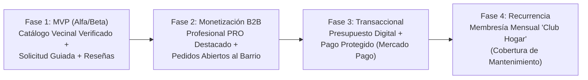

# Análisis Estratégico de Producto y Negocio — "Guía de Oficios"

> [!NOTE]
> Este documento resume la visión estratégica del proyecto, el modelo de negocio por etapas (MVP -> Evolutivos) y los mecanismos diseñados para evitar los problemas clásicos de las plataformas de servicios para el hogar.

---

## 1. El Problema que Resolvemos

Hoy la contratación de oficios (plomeros, gasistas, electricistas, instaladores de aire acondicionado, pintores, albañiles, jardineros, cerrajeros) está dispersa entre grupos de Facebook informales, pines desactualizados en Google Maps o cadenas de WhatsApp vecinales.

* **Dolor del Vecino / Cliente (especialmente adultos mayores):** Miedo a meter a un desconocido en la casa, falta de referencias comprobables, precios sorpresa al terminar el trabajo y aplicaciones complejas difíciles de entender.
* **Dolor del Profesional de Oficio:** Inestabilidad laboral, pérdida de tiempo yendo a presupuestar a barrios lejanos sin concretar, y falta de una vidriera profesional donde se valore su matrícula, puntualidad y prolijidad.

---

## 2. Decisiones Clave de Producto (Por qué Guía de Oficios funciona)

### A. Cómo Evitar la "Fuga de Plataforma" sin Cobrar Comisión Temprana
En el **MVP (Alfa/Beta)** la aplicación funciona como un catálogo verificado y gratuito donde el arreglo se coordina directamente por WhatsApp o llamada telefónica.
* **El mecanismo de registro previo:** Antes de abrir WhatsApp o el marcador telefónico (Pantallas 6 y 7 de Stitch), el vecino pasa por un paso guiado muy simple donde indica la urgencia y el problema (*"Pierde agua la canilla de la cocina"*).
* **Por qué es fundamental:** Ese paso registra la **Solicitud (`service_request`)** en nuestro backend Golang. Gracias a eso:
  1. El profesional recibe el pedido estructurado en su **Panel Profesional (Pantalla 10)**.
  2. Una vez terminado el trabajo, la plataforma habilita la **Calificación Verificada (Pantalla 8)**, sumando `+1 Trabajo Realizado` y mejorando el promedio de estrellas del profesional.
  3. El profesional tiene un incentivo directo para que todos sus clientes lo contacten por **Guía de Oficios**: su reputación barrial verificada es su mayor capital de trabajo.

### B. Estrategia de Lanzamiento Alfa/Beta: Hiper-Localización Barrial
Para que el marketplace tenga liquidez inmediata, el lanzamiento Alfa/Beta se concentra por barrios definidos (ej. **Caballito, Flores, Parque Chacabuco, Almagro**) y en los 8 oficios principales. Es mucho más valioso tener 15 profesionales verificados y activos en un radio de 3 km que cientos dispersos sin disponibilidad.

---

## 3. Roadmap de Evolutivos y Monetización

### Fase 2: Profesional Destacado (PRO) y Pedidos Abiertos
* **Suscripción Profesional PRO:** Cuota fija mensual accesible para el trabajador que le otorga posicionamiento prioritario en las búsquedas de su barrio, estadísticas avanzadas de contactos y alertas inmediatas, **siempre condicionado a mantener una calificación >= 4.2 estrellas** para cuidar la confianza de los vecinos.
* **Pedidos Abiertos:** Cuando el vecino usa el botón *"¿No sabés qué profesional necesitás?"*, puede publicar el desperfecto para que hasta 3 profesionales cercanos le envíen su presupuesto.

### Fase 3: Pagos Integrados en Plataforma
* Posibilidad de abonar la visita o el trabajo completo en cuotas mediante **Mercado Pago** dentro de la aplicación, reteniendo el dinero en garantía hasta que el vecino confirma que el trabajo se realizó con éxito.

### Fase 4: Suscripción Mensual para Clientes ("Membresía Hogar")
* Modelo de ingreso recurrente similar a una cobertura preventiva para el hogar:
  * **Carencia inicial de 15-30 días** (o descuento por pago semestral/anual) para evitar que alguien se suscriba únicamente el día que ya tiene una rotura grave y se dé de baja.
  * **Beneficios incluidos:** 2 visitas técnicas y diagnósticos 100% bonificados por mes, 1 servicio de mantenimiento preventivo semestral gratis (ej. limpieza de filtros de aire acondicionado antes del verano o revisión de estufas antes del invierno) y descuento del 15-20% en mano de obra para reparaciones mayores.
